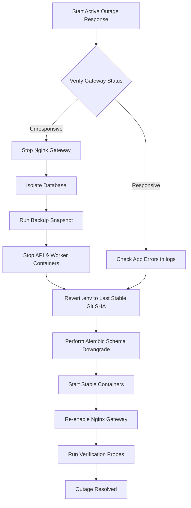

# NomadX Rollback Strategy & Execution Playbook

This playbook defines the strategies and exact commands to roll back application code, database migrations, worker loops, and network gateway routing in the event of a failed production deployment or critical incident.

---

## 1. Application Container Rollback

If a newly deployed API container displays degraded performance, excessive latency, or unmasked `500` errors:

1. Identify the active and previous stable Docker image tags in the image registry:
   * **Active (Failing)**: `nomadx-api:v1.1.0` (or Git SHA `8bc9a2`)
   * **Stable (Target Rollback)**: `nomadx-api:v1.0.9` (or Git SHA `2ef3b4`)
2. Update the image reference inside your `.env` file or orchestrator config:
   ```bash
   # In .env:
   # API_IMAGE_TAG=v1.0.9
   ```
3. Re-deploy the API containers using a rolling update strategy to prevent downtime:
   ```bash
   docker compose up -d --no-deps --build nomadx-api
   ```
4. Verify HTTP traffic routes to the stable container version:
   ```bash
   curl -k https://localhost/health
   ```

---

## 2. Database Migration Rollback

If a schema migration introduces locking issues, query bottlenecks, or table conflicts:

> [!CAUTION]
> Downgrading a database schema is potentially destructive. If new records have been created with fields introduced in the failed migration, those fields will be dropped. Ensure a snapshot backup is completed before proceeding.

### Step 2.1: Run a Backup Snapshot
```bash
bash /app/scripts/backup.sh
```

### Step 2.2: Identify the Downgrade Target Revision
Find the current migration revision and the revision preceding the failed release:
```bash
# View migration history
docker compose run --rm nomadx-api alembic history --verbose
```
Look for target versions:
* Current (Failed Revision): `754be8788321` (Initial schema example)
* Target (Previous Stable Revision): `a1b2c3d4e5f6`

### Step 2.3: Execute Downgrade
Downgrade exactly one revision, or downgrade to the target revision:
```bash
# Downgrade exactly 1 level
docker compose run --rm nomadx-api alembic downgrade -1

# Or downgrade to a specific revision
docker compose run --rm nomadx-api alembic downgrade a1b2c3d4e5f6
```

### Step 2.4: Data Remediation
If the failed migration deleted or split column data, run custom script adapters from your backup snapshot to restore data alignment.

---

## 3. Worker & Queue Rollback

The background scheduler coordinates 16 concurrent loop tasks (see [main.py (Worker)](file:///d:/Blockchain_Projects/NomadX/apps/worker/main.py#L136-L153)). During rollback, workers must drain queue tasks gracefully to prevent partial execution states.

### Step 3.1: Trigger Graceful Worker Shutdown
Send `SIGTERM` to the worker process container. The event loop signal handler catches this and marks the shutdown event (see [main.py (Worker)](file:///d:/Blockchain_Projects/NomadX/apps/worker/main.py#L111-L120)), allowing running loop items to finish execution:
```bash
# Stop worker container gracefully (default 10s timeout)
docker compose stop nomadx-worker
```

### Step 3.2: Revert Worker Image Tag
Change the worker tag in `.env` to match the stable version:
```bash
# In .env:
# WORKER_IMAGE_TAG=v1.0.9
```

### Step 3.3: Restart Worker
```bash
docker compose up -d nomadx-worker
```

---

## 4. Gateway & Reverse Proxy Routing Rollback

If the Nginx configuration is updated incorrectly (causing invalid CORS headers or connection dropouts):

1. Restore the previous stable Nginx config file from version control:
   ```bash
   git checkout HEAD~1 nginx/nginx.conf
   ```
2. Test Nginx syntax configuration before reloading:
   ```bash
   docker compose exec nginx-gateway nginx -t
   ```
3. Reload Nginx without dropouts:
   ```bash
   docker compose exec nginx-gateway nginx -s reload
   ```

---

## 5. Emergency Rollback Playbook (Under Active Outage)

If the entire system crashes and the API is unresponsive:



### Emergency Sequence Script
Run the following script to execute a full environment emergency restore to a designated target version:
```bash
#!/bin/bash
set -e

STABLE_VERSION="v1.0.9"

echo "[Emergency Rollback] Initiating system rollback to stable target: ${STABLE_VERSION}"

# 1. Stop ingress
docker compose stop nginx-gateway

# 2. Backup database in current state
bash /app/scripts/backup.sh

# 3. Stop running services
docker compose stop nomadx-api nomadx-worker

# 4. Revert config tags
sed -i "s/API_IMAGE_TAG=.*/API_IMAGE_TAG=${STABLE_VERSION}/g" .env
sed -i "s/WORKER_IMAGE_TAG=.*/WORKER_IMAGE_TAG=${STABLE_VERSION}/g" .env

# 5. Bring database structure down to stable version (if schema changed)
docker compose run --rm nomadx-api alembic downgrade -1

# 6. Restart stable services
docker compose up -d postgres redis nomadx-api nomadx-worker

# 7. Start Gateway
docker compose up -d nginx-gateway

echo "[Emergency Rollback] Rollback completed. Running verification..."
curl -k -f https://localhost/health
```
